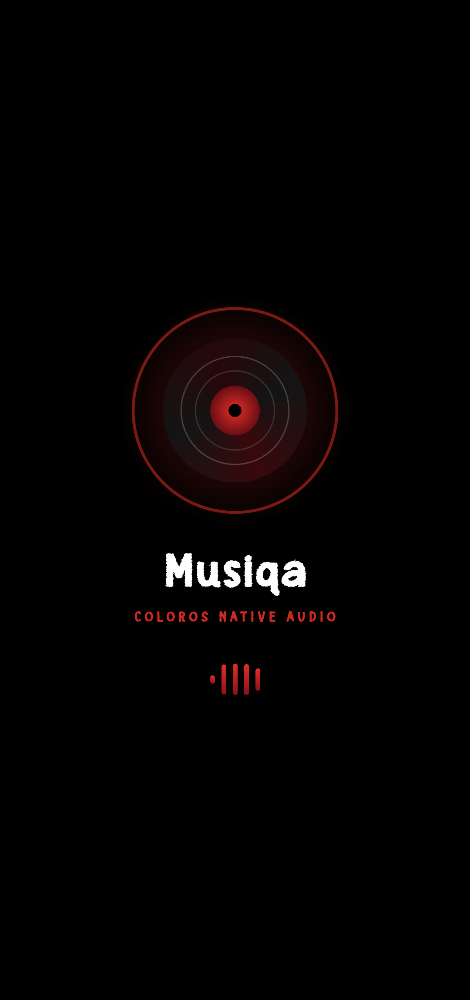
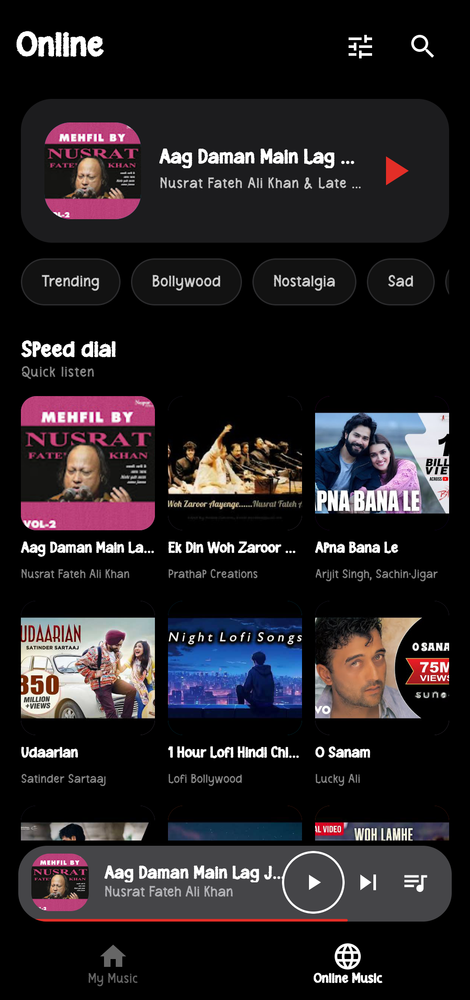
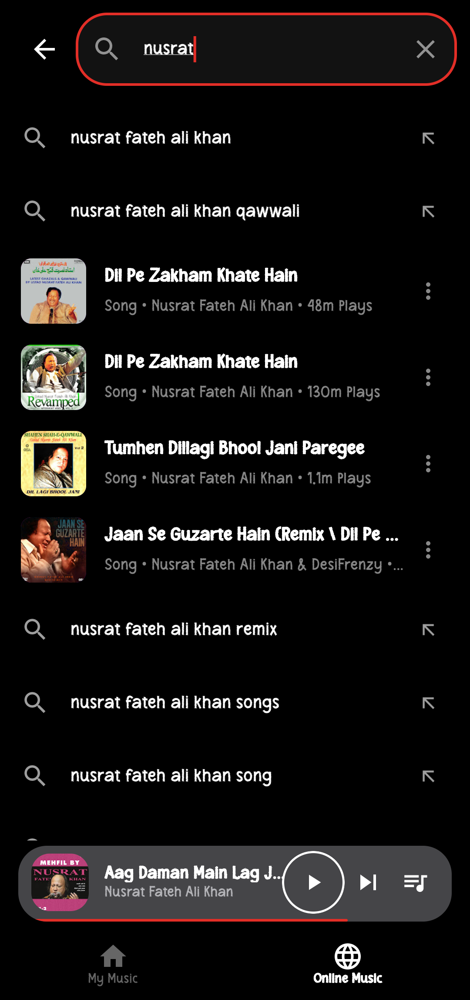
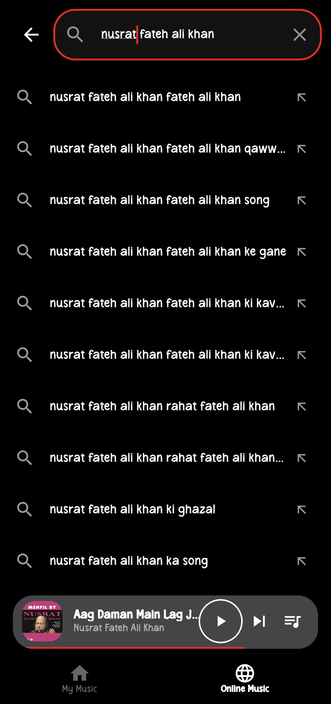
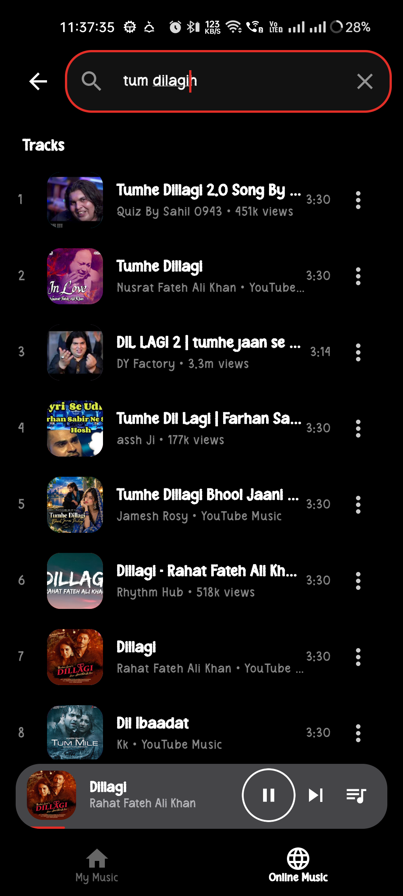
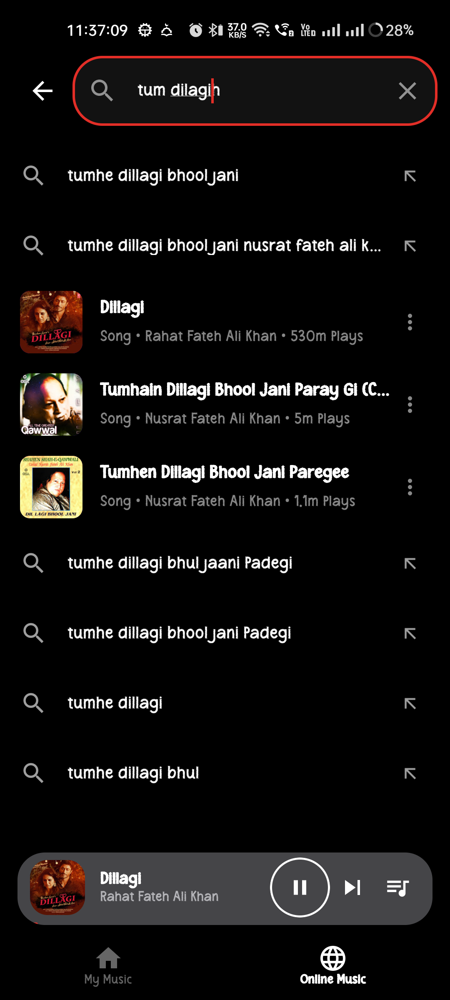
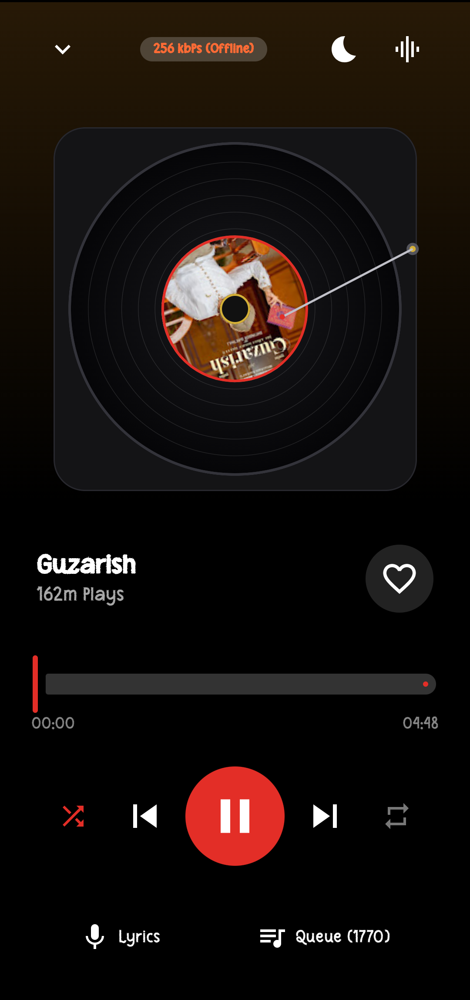
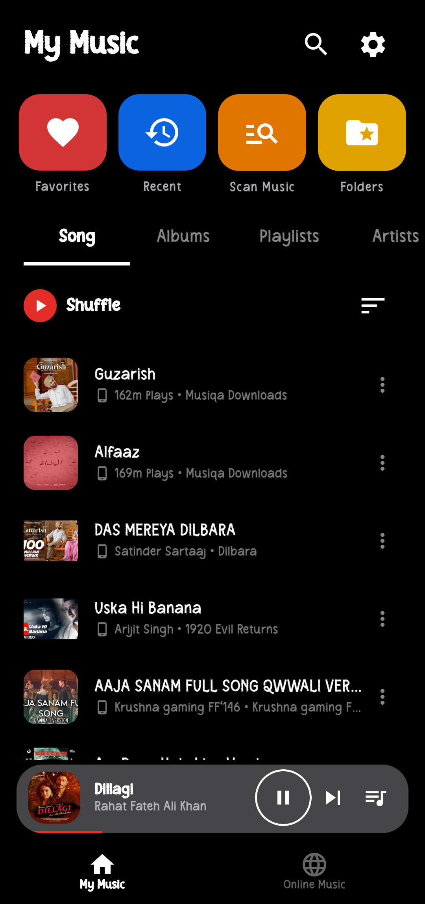

# Musiqa 🎵

<p align="center">
  
</p>

<p align="center">
  <a href="https://github.com/Ahmad10Raza/Musiqa/releases/latest"></a>
  <a href="https://developer.android.com"></a>
  <a href="https://kotlinlang.org"></a>
  <a href="https://developer.android.com/jetpack/compose"></a>
  <a href="LICENSE"></a>
</p>

---

## 🌟 Overview

**Musiqa** is a modern, high-performance Android music player designed for listeners who want simplicity, speed, and premium audio quality. Built with **100% Jetpack Compose** and **AndroidX Media3 (ExoPlayer)**, Musiqa unifies local offline music playback and online catalogue streaming into an AMOLED dark experience.

Whether playing high-fidelity offline FLAC/MP3 files from device storage or streaming online masterpieces, Musiqa offers isolated playback contexts, smart recommendations, anti-flicker loading, and an interactive search engine inspired by YouTube Music.

---

## 🚀 Key Features & Functionality

### 1. 🔍 Interactive YouTube Music-Style Search Engine
- **Debounced Autocomplete Suggestions**: As you type (debounced at 250ms), Musiqa fetches live suggestions without screen flickers or premature *"No matches found"* messages.
- **Query Refinement & Concatenation (`↖`)**: Each text suggestion includes a search icon (`🔍`) on the left and a diagonal arrow (`↖`) on the right. Tapping the arrow appends the suggestion directly into the search bar without triggering search immediately, allowing iterative query refinement.
- **Interleaved Playable Song Cards**: Song entity cards (with cover artwork, title, subtitle, play counts, and 3-dot action menu) appear interleaved directly between query suggestions. Tapping any song card begins playback instantly.
- **Committed Search with Multi-Signal Authority Ranking**:
  - **Artist Authority Scoring**: Official Artist Channels, Topic channels, and verified labels (*EMI, Saregama, T-Series, Tips, YRF*) receive heavy positive ranking.
  - **Amateur Clip Deprioritization**: Re-uploads, 30-second shorts, and status edits are penalized.
  - **Full-Length Preference**: Preserves original full-length recordings (e.g., 20+ minute authentic Qawwalis and Ghazals).
  - **Junk & Podcast Elimination**: Automatically purges non-music podcasts and lectures.

### 2. 💽 Retro Vinyl Now Playing Screen
- **Rotating Vinyl Disc**: Real-time rotating record animation with dynamic tonearm movement matching play/pause states.
- **Audio Quality Badge**: Dynamic bitrate and source indicators (e.g., `256 kbps (Offline)` or `HQ Online Stream`).
- **Synchronized Lyrics**: Dedicated lyrics sheet viewer with quick toggle.
- **Full Queue Manager**: Draggable, scrollable queue with current track highlighting and skip controls.

### 3. 📱 Dual Context-Aware Audio Engine (Local & Online Harmony)
- **Zero Queue Contamination**: Musiqa maintains independent state for the local library (`_localQueue`) and online discovery (`_onlineQueue`).
- **Unified Media Source Architecture**: Uses a hybrid `DefaultDataSource.Factory` wrapping `OkHttpDataSource`, guaranteeing seamless playback of local `content://` / `file://` URIs and remote HTTP/HTTPS audio streams without collision.
- **Adaptive Tab Selection**: Automatically coordinates audio context depending on whether you're managing local audio in **My Music** or exploring in **Online Music**.

### 4. 📻 Smart Radio & Curated Mood Categories
- **Live Watch-Next Radio**: Automatically seeds a 50-track dynamic radio queue based on YouTube Music's recommendation system (`RDAMVM`).
- **Mood-Fatigue Prevention**: Restricts consecutive tracks from the same artist to at most 2, following a balanced 60/25/15 ratio (core artist, domain peers, uplifting discovery).
- **Curated Category Shelves**: Native shelves for *Bollywood*, *Nostalgia* (90s/2000s classics), *Sad*, and *Sufi & Qawwali*.

---

## 📸 Screenshots & Visual Walkthrough

| 1. Animated Splash Screen | 2. Online Catalogue Home | 3. Interactive Search | 4. Query Refinement (`↖`) |
|:---:|:---:|:---:|:---:|
|  |  |  |  |
| Concentric red vinyl glow & audio waves | Trending shelves & mood categories | Debounced queries & interleaved cards | Tap `↖` to refine queries iteratively |

| 5. Committed Search Results | 6. Direct Card Playback | 7. Vinyl Now Playing Player | 8. Local Library ("My Music") |
|:---:|:---:|:---:|:---:|
|  |  |  |  |
| Authority ranked songs & view counts | Instant streaming from suggestion card | Rotating vinyl, bitrate badge & lyrics | MediaStore scanner & offline filters |

---

## 📥 Download & Installation

### Option 1: Direct APK Download (Recommended)
Download the latest signed release APK directly from GitHub Releases:

👉 **[Download Musiqa v1.0.0 APK](https://github.com/Ahmad10Raza/Musiqa/releases/download/v1.0.0/Musiqa-v1.0.0.apk)**

1. Transfer or download the APK to your Android device (Android 8.0+ / API 26+).
2. Tap the downloaded APK to install (enable *"Install unknown apps"* if prompted).
3. Grant Audio/Media permissions on first launch to allow indexing your offline music.

---

## 🛠️ Building from Source

### Prerequisites
- **JDK**: Java 17 or higher
- **Android SDK**: Android 14 (API 34) platform tools & build tools
- **Gradle**: 8.14+ (wrapper included)

### Build Instructions
```bash
# Clone the repository
git clone https://github.com/Ahmad10Raza/Musiqa.git
cd Musiqa

# Build debug APK
./gradlew assembleDebug

# Build signed release APK
./gradlew assembleRelease
```

The output APK will be generated at:
```
app/build/outputs/apk/release/app-release.apk
```

---

## 🏛️ Architecture & Tech Stack

- **UI Framework**: [Jetpack Compose](https://developer.android.com/jetpack/compose) with Material Design 3
- **Audio Engine**: [AndroidX Media3 (ExoPlayer)](https://developer.android.com/guide/topics/media/media3)
- **Language**: Kotlin 2.0 (Coroutines & StateFlow)
- **Image Loading**: [Coil Compose](https://coil-kt.github.io/coil/compose/)
- **Networking**: [OkHttp 4](https://square.github.io/okhttp/)
- **Local Media**: Android `MediaStore` ContentProvider query engine
- **Theme**: Pure Dark / AMOLED Palette (`#000000`, `#121212`, `#E53935`)

---

## 📂 Project Structure

```
Musiqa/
├── app/
│   ├── src/main/java/com/musiqa/player/
│   │   ├── audio/              # ExoPlayer & PlayerController, MediaSession
│   │   ├── data/               # Local repository, MediaStore queries, Room
│   │   ├── online/             # YouTube Music engine, suggestions, ranking
│   │   ├── ui/                 # Jetpack Compose UI
│   │   │   ├── components/     # MiniPlayer, NowPlaying, Artwork, Skeletons
│   │   │   ├── screens/
│   │   │   │   ├── library/    # Local library ("My Music")
│   │   │   │   └── online/     # Online home, search, suggestions, categories
│   │   │   └── theme/          # AMOLED dark theme & typography
│   │   └── MainActivity.kt     # App entry point, navigation, tab dispatch
│   └── build.gradle.kts
├── screenshots/                # Showcase screenshots for README
└── README.md
```

---

## 📄 License

```
Copyright 2026 Ahmad Raza

Licensed under the Apache License, Version 2.0 (the "License");
you may not use this file except in compliance with the License.
You may obtain a copy of the License at

    http://www.apache.org/licenses/LICENSE-2.0

Unless required by applicable law or agreed to in writing, software
distributed under the License is distributed on an "AS IS" BASIS,
WITHOUT WARRANTIES OR CONDITIONS OF ANY KIND, either express or implied.
See the License for the specific language governing permissions and
limitations under the License.
```

---

<p align="center">
  Crafted with ❤️ by <a href="https://github.com/Ahmad10Raza">Ahmad Raza</a>
</p>
